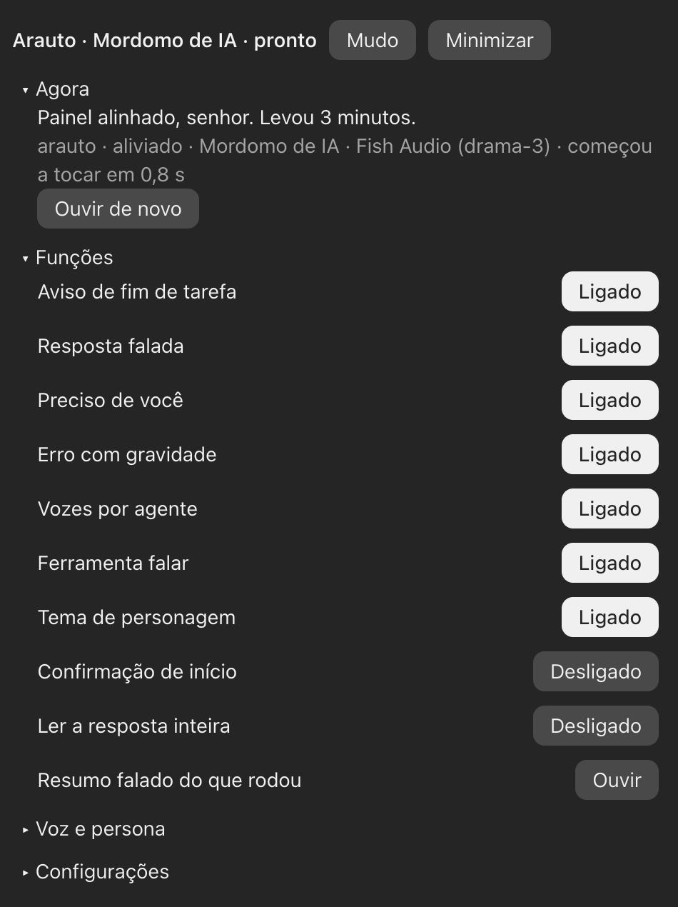
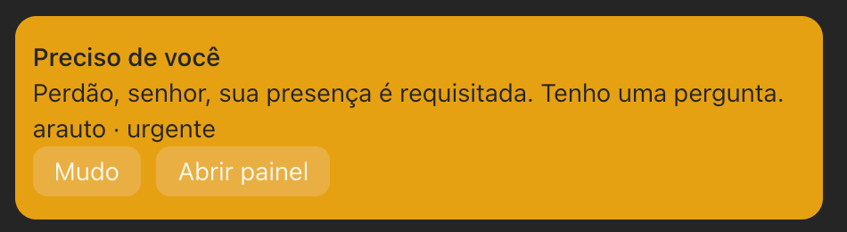

# Arauto

**O Claude Code avisa falando.** Você deixa a tarefa rodando, vai fazer outra coisa, e o Arauto te chama quando termina, quando precisa de você ou quando algo dá errado. A voz vem da [Fish Audio](https://fish.audio), modelo **Drama 3**, com emoção escolhida pelo próprio Claude.

Um mod do Claude Code (funciona no terminal e na aba Code do app Claude no Mac). Precisa do Claude Code 2.1.330 ou mais novo (`claude update`).



## O que ele faz

| Função | O que faz |
|---|---|
| Aviso de fim de tarefa | Fala até duas frases curtas quando termina, no tom do resultado |
| Resposta falada | Um resumo falado da resposta, em vez de ler tudo |
| Preciso de você | Avisa com urgência quando vai pedir permissão; o cartão fica âmbar |
| Erro com gravidade | Quando um comando falha, resume em uma frase |
| Vozes por agente | Cada subagente fala com uma voz |
| Ferramenta falar | O próprio Claude decide quando avisar e com que emoção |
| Tema de personagem | Uma saudação ao abrir a sessão |
| `/resumo` | Resumo do que rodou, em formato de podcast com duas vozes |
| `/voz` | Liga, desliga ou troca a voz (`/voz fish`, `/voz mac`) |



Nunca fala código, caminhos, links, chaves, tokens ou senhas. Se a Fish falhar, a mesma frase sai na voz do Mac.

## Instalar

1. **Chave da Fish Audio.** Crie em [fish.audio › Desenvolvedor › Chaves API](https://fish.audio/app/api-keys/). A API é paga por uso, sem assinatura; uma fala do Arauto custa uma fração de centavo.
2. **Guarde a chave sem ela aparecer na tela** (cole quando pedir e aperte Enter):

   ```zsh
   mkdir -p ~/.config/arauto && read -s "k?Chave da Fish Audio: " && printf 'Authorization: Bearer %s\n' "$k" > ~/.config/arauto/fish-audio.header && chmod 600 ~/.config/arauto/fish-audio.header && unset k && echo ok
   ```

3. **Instale o mod** (no terminal):

   ```
   claude plugin install arauto --marketplace mackswendhell/arauto
   ```

   Responda `y` para adicionar o marketplace e Enter no escopo de usuário. Ele passa a rodar em toda sessão nova do Claude Code neste Mac.

4. **Opcional, para começar a falar mais rápido:** `brew install mpg123`.

Abra uma sessão nova: o painel do Arauto aparece na lateral. `/arauto` abre o painel a qualquer momento.

## Vozes

Vêm prontas três vozes da biblioteca da Fish (Mordomo de IA, Narrador e Voz feminina). Para trocar, use o painel em **Voz e persona**, ou peça ao Claude: "troca a voz do Arauto por outra da biblioteca da Fish".

## Quer um mod seu?

O Arauto nasceu de um pedido em linguagem natural ao próprio Claude Code: "cria um mod chamado Arauto que dá voz para você…". O arquivo [ideia-do-mod.md](ideia-do-mod.md) é a ideia que ele seguiu. Dá para pedir um mod para qualquer coisa do mesmo jeito.

---

**English:** Arauto is a Claude Code mod that speaks: it tells you out loud when a task finishes, when it needs your approval, or when something fails, using the Fish Audio **Drama 3** model with emotion chosen by Claude. Store your Fish Audio key with step 2, then `claude plugin install arauto --marketplace mackswendhell/arauto`.
